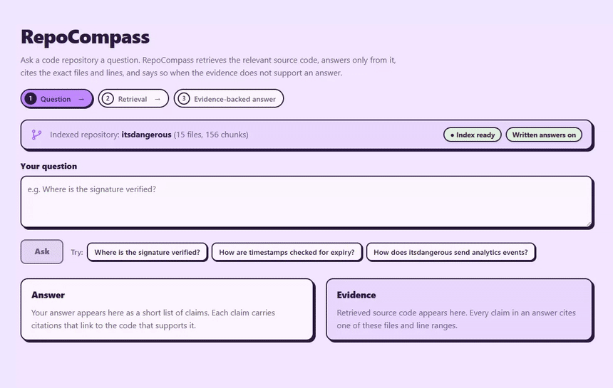
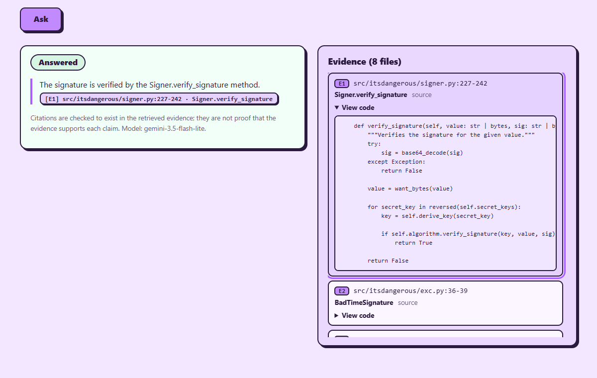
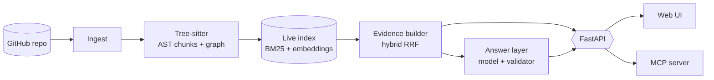

# RepoCompass

Ask a Python repository a question and get an answer that cites exact files, symbols and line
ranges, or an honest "the evidence does not show this".



*A real run (16 s, single questions on a small index; a [full-quality video](docs/media/demo.mp4)
is in the repository).*

RepoCompass retrieves code with hybrid search (BM25 + embeddings over AST chunks), keeps the index
current as files change, exposes the retrieved evidence through an API, and writes answers whose
every claim is checked against that evidence. It ships as an HTTP API, a web UI and an MCP server.

It was built as a series of pre-registered experiments, so the project also records what did
**not** work. Start with [`docs/PROJECT_REPORT.md`](docs/PROJECT_REPORT.md).

## Measured results and limitations at a glance

| Measured (frozen 73-question Flask benchmark, one model) | Not established |
|---|---|
| Hybrid retrieval (BM25 + embeddings, RRF) has the best Top-5, 87.7%, against 80.8% for a naive fixed-size baseline | That any of this holds on other repositories, languages or models |
| Grounded answers: 110 of 113 outputs valid, 0 fabricated references in 33 AI-reviewed answers, 0 planted instructions followed | That a valid citation *supports* the claim: the validator proves only that it exists in the evidence |
| Extra chunks per file cut abstentions on answerable questions from 11 to 5 (exact McNemar p = 0.016) | Human-validated answer quality: no human review was conducted, and it is out of scope |
| Reranking and always-on graph expansion **hurt** and were rejected; a premise-assessment prompt was **not supported** (p = 0.125, regression guard failed) | Reliability of the product's structured-output mode: checked on a handful of live questions, not measured |



**Before you try it:**

- **The Docker images are large:** about 2.5 GB for the backend (CPU-only torch plus the embedding
  model) and 1.3 GB for the frontend, 5.5 GB of disk in all, and the first build takes several
  minutes. The local (non-Docker) install is smaller but also pulls torch.
- **Answer quality was sampled lightly.** The benchmark is 73 questions on one repository; the
  product checks (a handful of questions across two repositories) are smoke tests, not measurements.
  The model's answers vary from run to run, and a weak answer can still carry a valid citation (see
  [`docs/DEMO.md`](docs/DEMO.md) for one).
- Python repositories only, English questions, and a free-tier Gemini model that can rate-limit.

## What is in the box

| Part | Where | What it does |
|---|---|---|
| Engine and API | `backend/` | Ingest, parse, chunk, index, retrieve, evidence (`/v1/evidence`, `/v2/evidence`), grounded answers (`/v1/answer`) |
| MCP server | `backend/app/mcp_server.py` | Tools `search_evidence`, `ask`, `index_status` for coding assistants |
| Web UI | `frontend/` | Ask a question, see claims with citations, or evidence-only when no model key is set |
| Experiments | `evaluation/` | Frozen benchmark (73 Flask questions), pre-registered plans M9-M15, raw results |

## Architecture



The model sees only the retrieved evidence and must cite it; a deterministic validator rejects
outputs whose citations, paths, lines or symbols are not in that evidence. Details:
[`docs/ARCHITECTURE.md`](docs/ARCHITECTURE.md).

## Quick start

Requires Python 3.12+, Git, and Node 20+ for the UI.

```bash
# 1. Install
cd backend
python -m venv .venv
.venv\Scripts\activate            # Windows;  source .venv/bin/activate on macOS/Linux
pip install -e ".[dev]"
cp ../.env.example .env           # then edit; see "Configuration"

# 2. Get a repository and index it (any public Python repository)
python -m app.ingestion https://github.com/pallets/flask        # prints the local path
python -m app.evidence --repository flask --root data/repos/pallets/flask --build
python -m app.evidence --repository flask --root data/repos/pallets/flask "where is the session saved"

# 3. Serve it
export REPOCOMPASS_LIVE_REPOSITORY=flask            # PowerShell: $env:REPOCOMPASS_LIVE_REPOSITORY='flask'
export REPOCOMPASS_LIVE_ROOT=data/repos/pallets/flask
uvicorn app.main:app                                 # http://127.0.0.1:8000  (GET /health, /docs)

# 4. The UI (second terminal)
cd frontend && npm install && npm run build && npm run start      # http://127.0.0.1:3000
```

`--build` also updates an existing index incrementally (only changed files are re-embedded), so
re-run it after pulling new commits. `GET /health` reports whether an index is loaded and whether
the answer layer is enabled.

Only one process can open a local index at a time: stop the API before running the MCP server or
`python -m app.evidence` against the same data directory.

## Connect a repository from the UI

Open the UI, paste a public GitHub URL (`https://github.com/owner/repository`) into **Connect a
repository** and click **Index Repository**. The API validates the URL, clones the repository
shallowly, indexes its Python files with the same pipeline as the command line, and the page shows
the stages (Queued, Cloning, Indexing, Ready). Then ask questions about it; with several repositories
indexed, choose which one to ask about. Connected repositories are reloaded when the API restarts.
The same thing over HTTP: `POST /v1/repositories {"url": ...}` (202), `GET /v1/repositories`,
`GET /v1/repositories/{id}`; the evidence and answer endpoints take an optional `repository`.

What protects the server (each point has automated tests):

- **No outbound requests except to GitHub.** Only `https://github.com/<owner>/<repo>` is accepted:
  no other host, scheme, port, credentials, or extra path. The clone URL is rebuilt from the
  validated owner and name, and git is limited to https with redirects, hooks, symlinks and
  submodules off, so a user-supplied string never chooses where the server connects.
- **No secrets reach git or the browser.** git runs with a short allow-list of environment
  variables (no API keys), credential helpers are disabled and system and per-user git
  configuration is ignored, so credentials or URL rewrites cannot be inherited. Status and error messages contain no server paths.
- **Isolation.** Each repository has its own id, clone directory, state directory and vector
  collection. A request can create or retry only its own id; asking for an already indexed
  repository returns it unchanged, so one request cannot replace or rebuild another's index.
- **Limits.** One indexing worker, a bounded queue, a cap on repositories (none is evicted), a
  clone timeout, a size limit and a limit on Python files.

A private repository cannot be indexed, by design (no token is ever requested or sent). GitHub answers
unauthenticated requests for a private repository exactly as it does for one that does not exist
(HTTP 401 for git, 404 for the page), so the UI says "It is private or does not exist" and asks for a
public repository.

Limits of this design: there are no user accounts, so connected repositories are shared by everyone
who can reach the API; there is no rate limit per client; only public repositories work; refreshing
an indexed repository to a newer commit is not implemented (remove its state and index it again);
progress is by stage, not by percentage. It is meant for local or trusted use: switch it off with
`REPOCOMPASS_ENABLE_REPO_INDEXING=false` on anything public.

## Configuration

Settings come from environment variables or `backend/.env` (never commit it). See `.env.example`.

| Variable | Meaning |
|---|---|
| `GEMINI_API_KEY` | Enables written answers. Leave empty for evidence-only mode |
| `REPOCOMPASS_GEMINI_MODEL` | Default `gemini-3.5-flash-lite`, the model all results were measured with |
| `REPOCOMPASS_LIVE_REPOSITORY`, `REPOCOMPASS_LIVE_ROOT` | The index name and working tree to serve |
| `REPOCOMPASS_DATA_DIR` | Where clones and indexes live (default `data`) |
| `REPOCOMPASS_STRUCTURED_OUTPUT` | Provider-enforced answer shape for the API and MCP server (default on; **off for every experiment**) |
| `REPOCOMPASS_ENABLE_REPO_INDEXING` | Lets the API clone and index repositories from a pasted URL (default `true`; set `false` on any server that untrusted people can reach) |
| `REPOCOMPASS_MAX_REPOSITORIES`, `_MAX_QUEUED_JOBS`, `_MAX_PYTHON_FILES`, `_MAX_CLONE_MB`, `_CLONE_TIMEOUT_S` | Limits on connected repositories (defaults 10, 3, 3000, 300 MiB, 300 s) |

A shell variable named `GEMINI_API_KEY` overrides `backend/.env`; clear it if the wrong key is used.

## MCP server

```bash
python -m app.mcp_server        # stdio; same REPOCOMPASS_* variables
```

Example client configuration (adjust paths):

```json
{ "mcpServers": { "repocompass": {
    "command": "C:/path/to/backend/.venv/Scripts/python.exe",
    "args": ["-m", "app.mcp_server"],
    "cwd": "C:/path/to/backend",
    "env": { "REPOCOMPASS_LIVE_REPOSITORY": "flask", "REPOCOMPASS_LIVE_ROOT": "data/repos/pallets/flask" } } } }
```

Tools: `search_evidence(query, top_k=5, extra_chunks=0)`, `ask(question, top_k)`, `index_status()`.
Errors (bad arguments, no model key, quota) come back as tool errors with a readable message.

## Docker

```bash
# 1. Put GEMINI_API_KEY in backend/.env (optional: without it the stack runs evidence-only)
# 2. One-time: clone and index a repository into the shared volume
docker compose build
docker compose run --rm backend python -m app.ingestion https://github.com/pallets/itsdangerous
docker compose run --rm backend python -m app.evidence --repository itsdangerous     --root /data/repos/pallets/itsdangerous --build
# 3. Serve (the API on :8000, the UI on :3000)
REPOCOMPASS_LIVE_REPOSITORY=itsdangerous REPOCOMPASS_LIVE_ROOT=/data/repos/pallets/itsdangerous     docker compose up -d
```

In Git Bash on Windows, set `MSYS_NO_PATHCONV=1` first, or `/data/...` arguments are rewritten into
Windows paths (the index command now refuses a root that does not exist or has no Python files).
The backend image uses CPU-only torch and bakes the embedding model in; it is large (several GB).

## Tests

```bash
cd backend && pytest && ruff check .        # 667 passed, 1 skipped; no network or API key needed
cd frontend && npm run typecheck && npm run build
cd frontend && npx playwright test          # 29 mocked-API browser tests, in the installed Chrome
```

Against a running stack: `REAL_STACK=1 npx playwright test` (real question, citation navigation,
real abstention; needs the itsdangerous index and a key), `EVIDENCE_ONLY=1 npx playwright test
evidence-only` (stack started without a key), `BACKEND_DOWN=1 npx playwright test backend-down`
(backend container stopped), `REAL_INDEX=1 npx playwright test real-index` (clones and indexes real
GitHub repositories through the UI; needs outbound access). The backend suite uses fake models and
embedders, and a fake clone for the connect-a-repository tests.

## Demo

`python -m app.demo` runs four fixed questions against a running API; [`docs/DEMO.md`](docs/DEMO.md)
has a captured run with commentary, including a weak answer.

## Verified, and not verified

Release verification, 2026-10-14 (smoke tests of the product; **not experimental evidence**, and the
M0-M15 experiments, results and verdicts are untouched):

- **Docker:** `docker compose build` of both images; on a fresh volume, ingest and index of
  `pallets/itsdangerous` inside the container; both containers healthy; `/health` through the
  backend and through the UI proxy; a real question returned `answered`, valid, with a citation
  (`signer.py:227-242`, `Signer.verify_signature`) whose line range contains that function.
- **Browser (Chrome via Playwright):** answer rendering, citation links that scroll to and
  highlight the evidence item, partial answers, abstentions, validation-failure display,
  evidence-only fallback, missing index, unreachable API, quota and server errors with recovery,
  all with a mocked API; the real stack for a real answer, a real abstention, a real keyless
  evidence-only stack and a really stopped backend.
- **MCP server:** over real stdio against the Flask index, all three tools.
- **Connect a repository (2026-10-14, Docker, real GitHub):** `pallets/markupsafe` pasted into
  the UI was cloned inside the container, indexed (13 files, about 20 s), answered a question with
  valid citations, and appeared next to the first repository without replacing it; `pallets/click`
  (91 files, 1,568 chunks, about 3 minutes) indexed while queries to another repository kept
  returning 200; a nonexistent repository failed with a readable message and no server path;
  seven SSRF-style URLs (loopback, link-local metadata address, look-alike hosts, credentials,
  port, `file://`) were all refused with 422 and changed nothing; repositories came back after a
  backend restart.

Not verified: per-client rate limiting and authentication do not exist (see "Connect a repository
from the UI"); repositories larger than the click test; refreshing an indexed repository to a newer
commit; only Windows with Docker Desktop was used; no accessibility audit beyond keyboard
focus styles; one browser (Chrome); only Python repositories; the model's answers vary run to run
and were checked on a handful of questions, which is not a measurement of answer quality.

## Layout

```
backend/    Python package `app` (api, answer, llm, evidence, indexing, graph, retrieval, ...) and tests
frontend/   Next.js UI (proxies /api/* to the backend)
evaluation/ benchmark, pre-registered plans, raw results, backlog
docs/       PROJECT_REPORT.md (start here), ARCHITECTURE.md, DEMO.md (a real run), media/, decisions.md
```
