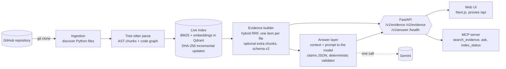

# Architecture

## Data flow for one question

1. **Retrieve.** The question is searched with BM25 (code-aware tokenizer) and with embeddings
   over AST chunks. The two rankings are fused with reciprocal rank fusion (k = 60) and collapsed
   to one item per file. Each item carries the file, its SHA-256, a line range, the symbol and the
   scores. Graph relationships (calls, imports) are attached as annotations and never reorder
   results.
2. **Build the context.** The evidence items become numbered blocks (`E1`, `E2`, ...; with schema
   v2, extra chunks are `E1b`, `E1c`) inside a character budget.
3. **Ask the model once.** The model sees only the system prompt and the evidence blocks. It has no
   tools, files or search. It must return `{status, claims[{text, citations}], missing}`.
4. **Validate.** A deterministic validator checks that the output is the right shape, that every
   claim has citations, that cited ids exist, and that any path, line number or symbol named in a
   claim appears in the evidence. A failing output is returned as `invalid_output` with its
   reasons and no answer text.
5. **Resolve.** Valid citations are resolved through the evidence response (never through the
   model's own words) into file, line range and symbol.

## Invariants worth knowing

- The answer layer can only see the repository through the Evidence API (plan rule R1 of M13).
- Validity is not truth: the validator proves that citations point at something in the evidence,
  not that the evidence supports the claim.
- A live index updates incrementally: only files whose SHA-256 changed are re-parsed and
  re-embedded, and the result equals a full rebuild (verified in 11 of 11 scenarios, M11).
- Two modes of generation exist. Every published experiment used prompt-only JSON. The API and
  MCP server default to a provider-enforced response schema (`REPOCOMPASS_STRUCTURED_OUTPUT`),
  which removes malformed-claim failures but was not part of any measurement.

## Where the code is

| Concern | Package |
|---|---|
| Clone, discover files | `backend/app/ingestion` |
| Parse, chunk, graph | `backend/app/{parsing,chunking,graph}` |
| Index, incremental updates | `backend/app/indexing` |
| Retrieval (BM25, embeddings, RRF) | `backend/app/retrieval` |
| Evidence API | `backend/app/evidence`, `backend/app/api/evidence.py` |
| Answers, validator, prompts | `backend/app/answer`, `backend/app/llm` |
| MCP server | `backend/app/mcp_server.py` |
| UI | `frontend/` |
| Experiments (frozen plans, raw results) | `evaluation/` |
